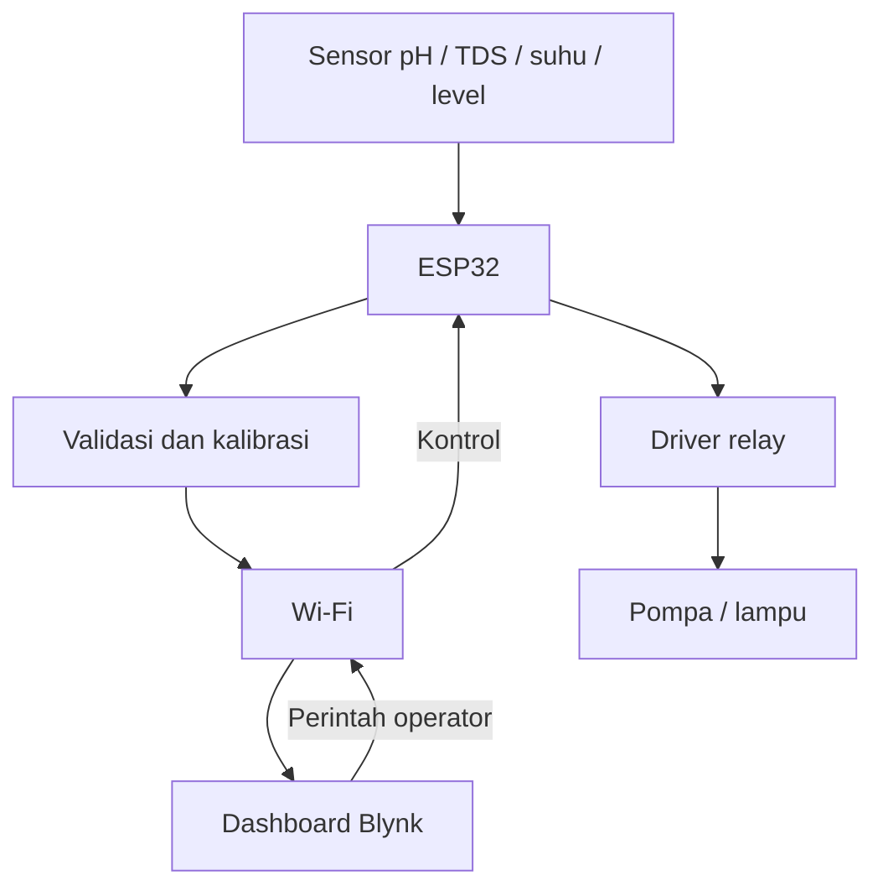

# Arsitektur Sistem HYDROSENSE

## Alur data
1. Sensor mengukur parameter larutan dan lingkungan.
2. ESP32 membaca sinyal sensor melalui ADC/digital interface.
3. Firmware melakukan validasi, konversi, dan kalibrasi.
4. ESP32 mengirim telemetri melalui Wi-Fi ke platform IoT (contoh: Blynk).
5. Dashboard menampilkan data dan menerima perintah operator.
6. Firmware mengendalikan driver/relay sesuai mode manual atau aturan otomatis.

## Lapisan
- Perangkat: sensor, ESP32, catu daya, driver aktuator.
- Komunikasi: Wi-Fi dan protokol yang disediakan platform IoT.
- Aplikasi: dashboard, indikator status, kontrol manual, alarm.
- Keamanan: kredensial privat, validasi input, kondisi fail-safe.

## Catatan desain
Diagram menunjukkan rancangan konseptual. Komponen aktual, protokol, dan sambungan perlu disesuaikan dengan prototipe yang dibangun.
